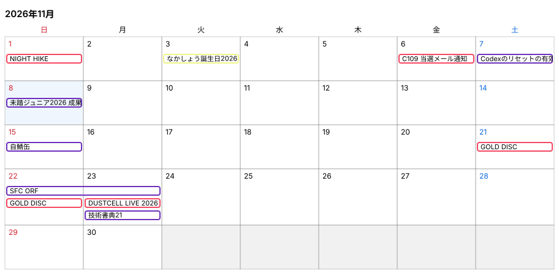
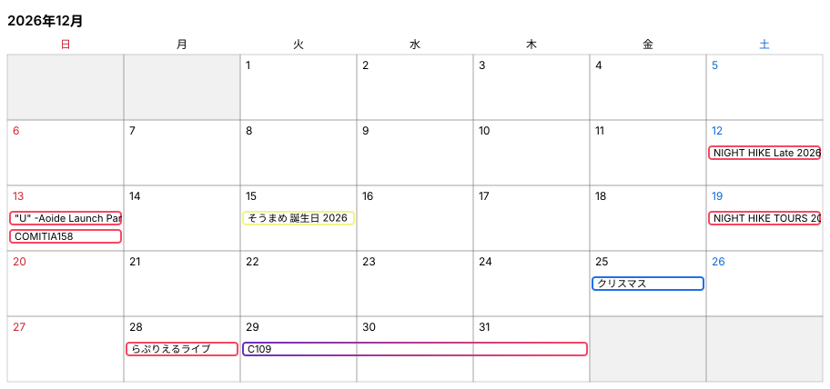

# カレンダー

<!-- zunocal:calendar:current:start -->

<!-- zunocal:calendar:current:end -->

<!-- zunocal:calendar:next:start -->

<!-- zunocal:calendar:next:end -->

[zunoser Project #3](https://github.com/orgs/zunoser/projects/3)

## 購読

[Google カレンダーに追加](https://calendar.google.com/calendar/r?cid=webcal%3A%2F%2Fraw.githubusercontent.com%2Fzunoser%2Fcalendar%2Fmain%2Fics%2Fcalendar.ics)

<details>
<summary>Apple カレンダー / Outlook:</summary>

```
webcal://raw.githubusercontent.com/zunoser/calendar/main/ics/calendar.ics
```

</details>

<details>
<summary>その他:</summary>

```url
https://raw.githubusercontent.com/zunoser/calendar/main/ics/calendar.ics
```

</details>

## AIに予定の登録を依頼する

次のプロンプトの「登録する予定」を書き換えて、GitHubを操作できるAIに渡す。

```text
https://github.com/zunoser/calendar に、次の予定をIssueとして登録してください。
登録する予定: <イベント名・公式URL・対象の開催回など>

1. 公式情報から開催日・時間・タイムゾーン・会場を確認し、同じ開催回のIssueが
   open / closedの両方に存在しないか検索してください。既存のIssueがあればURLを
   報告してください。開催回や日付を確定できなければ、作成前に確認してください。
2. Issueのタイトルを予定名にし、本文に開催日時・タイムゾーン・会場・出典URLを
   記載してください。昼夜など複数の部がある場合は、それぞれの日時を明記してください。
   対象リポジトリの既存ラベルを全ページ取得し、名前と説明から予定に合うラベルを
   選んで原則付けてください。一覧取得には、例えば次のコマンドを使えます。
   gh api --paginate repos/zunoser/calendar/labels --jq '.[] | {name, description}'
   ラベル名を推測して新規作成せず、適切な既存ラベルがなければ空欄にして理由を
   報告してください。
3. Issue typeと実際のIssueフィールドを次のとおり設定してください。
   - Issue type: Calendar（ラベルではなくType）
   - Start date: 開始日（YYYY-MM-DD）
   - Target date: 最終日（YYYY-MM-DD）。1日だけなら開始日と同じ日。
     翌朝まで続く予定は翌日を指定してください。iCalendarの排他的終了日に変換する
     処理はこのリポジトリが行うため、フィールドには実際の最終日を保存してください。
   - Location: 公式の会場名。複数会場は各部との対応を記載し、未発表なら空欄。
   - Date status: 日付の確定と開始日≦最終日を確認してNext。
   日付は開催地のタイムゾーンに従ってください。Priority・Effort・担当者は、
   指定された場合にだけ設定してください。
4. Type・フィールド・選択肢のIDは対象リポジトリの現在の定義から名前で解決してください。
   接続ツールで設定できない項目は、利用可能な認証済みのgh / GitHub APIで設定してください。
   IssueフィールドとProjectフィールドは別物です。本文やProjectへの記載だけでは
   完了にせず、Issue自身のフィールドへ保存してください。
5. 作成したIssueを再取得し、Type・ラベル・各フィールドの保存値を照合してください。
   URL・付けたラベル・保存値を報告して完了としてください。作成後に設定が失敗した場合は同じIssueで
   再試行し、重複作成を避けてください。権限不足などで完了できない場合は、作成済みの
   URLと未設定の項目を報告してください。
```

## コマンド

```sh
pnpm zunocal view                # カレンダーをテーブル表示
pnpm zunocal check [--dry-run]   # 日付の整合性を検査し Date status を Error/Next に更新
pnpm zunocal close [--dry-run]   # 終了日が過去の open な Issue を close
pnpm zunocal remind <days> [--dry-run] # 開始日の<days>日前に担当者全員を Issue コメントでメンション
pnpm zunocal ics [--out <path>]  # iCalendar を書き出す (既定: ics/calendar.ics)
pnpm zunocal svg --month YYYY-MM --output <path> # 指定月のSVGを1枚書き出す
pnpm zunocal readme <path> --tag <tag> [--alt <text>] [--readme <path>] # READMEの画像参照を差し替え
```

`svg` は指定した1か月・1ファイルだけを書き出し、READMEには触れない。
どの月を書き出すか・ファイル名をどう付けるかは呼び出し側が決める(ランダムな名前を付けると画像URLの衝突とキャッシュを避けられる)。
`readme` はREADMEの `<!-- zunocal:<tag>:start -->` 〜 `<!-- zunocal:<tag>:end -->` 内の画像参照を1枚に差し替える。それ以外のことはしない。旧ファイルの掃除も呼び出し側の責務 (daily.yml は render 前にまとめて削除している):

```sh
path="assets/calendar-current-$(openssl rand -hex 6).svg"
pnpm zunocal svg --month 2026-08 --output "$path"
pnpm zunocal readme "$path" --tag calendar:current
```

## 開発

Nix を利用する場合は、`direnv allow` または `nix develop` で Node.js と Corepack 管理の pnpm が入った開発環境を利用できる。

```sh
npm run setup
pnpm install
pnpm test              # ユニットテスト (純粋ロジックのみ)
pnpm test:integration  # 実 API への Read 専用テスト (要 TOKEN)
pnpm typecheck
pnpm lint
pnpm fmt
```

### リポジトリ基盤

`infra/github` では、バージョン固定した OpenTofu モジュール
`zunoser/tfmodule-gh-repo-kit` を使ってこのリポジトリを管理している。
state は共有 R2 バックエンドの
`github/repositories/calendar/terraform.tfstate` に保存し、リポジトリラベルは
`infra/github/labels.tf` でモジュールとあわせて宣言している。

認証情報なしで静的検証できる:

```sh
tofu -chdir=infra/github init -backend=false
tofu -chdir=infra/github validate
```

実際の plan には、R2 バックエンドの認証情報と GitHub トークンも必要になる。

### パッケージ構成

| パッケージ        | 役割                                                                                          |
| ----------------- | --------------------------------------------------------------------------------------------- |
| `packages/cli`    | コマンド定義と表示 ([citty](https://github.com/unjs/citty))                                   |
| `packages/core`   | 設定 (`parseConfig`) とサービス (`getGitHubCalendar`)、純粋なイベント操作                     |
| `packages/github` | GitHub GraphQL の repository 層 ([gql.tada](https://gql-tada.0no.co/) + graphql-request)      |
| `packages/ics`    | iCalendar 生成 ([ical-generator](https://github.com/sebbo2002/ical-generator) の薄いアダプタ) |
| `packages/svg`    | 月グリッドのカレンダー画像 (SVG) 生成                                                         |
| `packages/utils`  | 汎用ユーティリティ                                                                            |

GitHub の GraphQL スキーマは `packages/github/schema.docs.graphql` にベンダリングしている
([公式の公開スキーマ](https://docs.github.com/public/fpt/schema.docs.graphql) をダウンロードしたもの)。
スキーマを更新したら型定義を再生成する:

```sh
curl -sL -o packages/github/schema.docs.graphql https://docs.github.com/public/fpt/schema.docs.graphql
pnpm --filter @zunoser/calendar-github exec gql-tada generate-output
```
